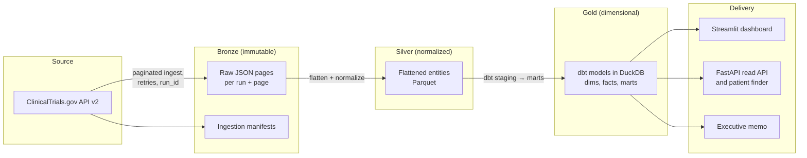
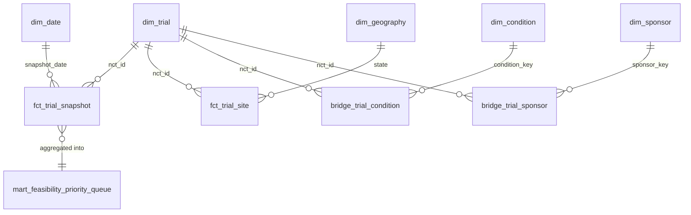

# Clinical Trial Access & Feasibility Intelligence

[](https://github.com/ne1cc/cti-dashboard/actions/workflows/ci.yml)

**Live demo:** [cti-trials.duckdns.org](https://cti-trials.duckdns.org) · an hourly workflow checks that it is up and that its data is fresh, and opens an issue when it is not.

**An open, multi-stakeholder clinical trial access and intelligence platform over public ClinicalTrials.gov registry data. No paywall and no black-box score: every number traces to NCT IDs you can open.**

Three audiences, one warehouse:

- **Patients and caregivers** search for recruiting trials near a ZIP code, read plain-language trial pages, and print a shortlist to take to an appointment. Contact guidance is privacy-first (ADR 0061, ADR 0065).
- **Researchers and feasibility analysts** compare competition, sponsor concentration, site overlap, geographic access, early stops and result posting across twelve disease presets or the whole registry.
- **Developers** get a read API (OpenAPI 3.1) over the same DuckDB/Parquet warehouse.

Counts describe registry listings under the rules shown on screen. They do not establish patient availability, recruitment prospects, or site performance.

## What you can try

| Surface | What it does | Where |
|---|---|---|
| **Patient trial finder** | Search by condition, ZIP and radius; filter by age, sex and status; open a plain-language page per trial (arms, placebo, masking, why it stopped, outcome timing); keep a client-side shortlist with a printable appointment reference; mobile layout. | `/` on the API app |
| **Dashboard, Overview** | Pick an **indication preset**, phase and captured snapshot; every page below follows that scope. | Streamlit `dashboard/app.py` |
| **Registry Segments** | Raw sortable segment metrics (recruiting trials, sponsor HHI, site overlap). No composite score (ADR 0077). | page 1 |
| **Competition Landscape**, **Sponsor Landscape**, **Site Overlap** | Who is recruiting where, how concentrated the sponsors are (HHI is suppressed below the minimum sponsor count), and which sites several trials share. | pages 2, 5, 4 |
| **Geography Trends** | State choropleth, population-adjusted per 100k residents (Census Vintage 2024) with a raw-count toggle, plus a **county access map**: which counties have a recruiting site within 25, 50 or 100 miles. | page 3 |
| **Access Rates** and **Participation vs Burden** | Recruiting trials per 100k residents or per 1,000 estimated cases for a MeSH condition; each group's share of reported trial participants against its share of disease burden (needs posted baseline demographics). | pages 10, 11 |
| **Data Reliability** and **Trial Transparency** | Run confidence, reconciliation and ingestion diagnostics; early-stopped trials and results posting. | pages 6, 9 |
| **Trial Explorer** and **Trial Similarity** | Browse and drill into a trial; similar precedents ranked from a MeSH-blocked candidate pool using weights in `config/similarity_weights.yml`. | pages 7, 8 |
| **Provenance drawer** | Open **Data coverage and caveats** on any page: exact filters, run IDs, contributing NCT IDs, exclusions, and a downloadable `competition-audit-v2` JSON. | every page |
| **Read API** | `GET /v1/trials`, `/v1/trials/{nct_id}`, `/v1/trials/{nct_id}/related`, `/v1/conditions` (consumer-friendly autocomplete with MeSH mapping), `/v1/geo/access`, `/v1/meta/freshness`. Keyset pagination, ETags, RFC 7807 errors, per-client rate limit on live routes. | [`docs/api/`](docs/api/) |

Run the dashboard in five minutes with synthetic data below, or start the finder and API as described under [Patient finder and API](#patient-finder-and-api).

## 5-minute quickstart (synthetic fixture data)

Prerequisites: Python 3.11+, [uv](https://docs.astral.sh/uv/), and a clone of this repository.
Run these commands from the repository root; no registry download or API key is needed:

```bash
uv sync --all-groups --frozen
export CTI_PROJECT_ROOT="$PWD/.scratch/fixture-demo"
uv run python -m tests.fixture_warehouse --root "$CTI_PROJECT_ROOT"
cd "$CTI_PROJECT_ROOT"
uv run streamlit run ../../dashboard/app.py
```

> [!NOTE]
> All sample records produced by `tests.fixture_warehouse` are synthetic fixtures designed for reproducible local testing and UI exploration. They do not represent live patient or study data.
> Start Streamlit from `$CTI_PROJECT_ROOT` so audit and staging views resolve relative
> Parquet paths from the fixture directory. A second fixture invocation refuses the
> nonempty destination. To reset, stop Streamlit and remove only the disposable
> `.scratch/fixture-demo` directory from the repository root, then rerun these commands.

**Start here:** [Project brief](docs/project_brief.md) ·
[National Phase 3 Alzheimer's disease case study](docs/feasibility_case_study.md) ·
[Metric definitions](docs/metric_definitions.md) ·
[Archived exploratory business case](docs/archive/business_case.md).
The case study uses an actual local captured dataset and a complete 50-state table;
D.C. and territories appear in a separate supplement. Its observations describe
that dataset, rather than the current live demo.

> **Validation status:** Pipeline checks, dbt contracts, and automated test suites
> are implemented. Commercial feasibility analyst workflows and operational ROI claims
> remain exploratory hypotheses (ADR 0082). Current development headlines the open
> multi-stakeholder access platform (ADR 0040).

---

## Patient finder and API

One FastAPI app serves both the server-rendered patient finder and the read API:

```bash
make gazetteer                                  # one-time: Census ZIP/place centroids into data/reference/
uv run uvicorn src.api.app:create_app --factory # then open http://localhost:8000/
```

- **Live mode (default):** with no warehouse configured, searches go to ClinicalTrials.gov API v2 with a SQLite response cache, a circuit breaker and a per-client rate limit. A recruiting-site radius filter runs on each page, so a page can hold fewer than `limit` results; see [`docs/api/live-backend.md`](docs/api/live-backend.md).
- **Warehouse mode:** `export CTI_WAREHOUSE_PATH=data/warehouse/clinical_trials.duckdb` serves the same contract from read-only DuckDB connections ([`docs/api/serving.md`](docs/api/serving.md)).
- **Finder pages:** `/` (search), `/trials` (results), `/trials/{nct_id}` (plain-language detail), `/shortlist` (printable). Query strings are stripped from access logs, and contact details are scrubbed from API payloads.
- **Contract:** [`docs/api/openapi.yaml`](docs/api/openapi.yaml), worked requests in [`docs/api/examples.md`](docs/api/examples.md), source-field mapping in [`docs/api/source-field-map.md`](docs/api/source-field-map.md).
- **Freshness:** `GET /v1/meta/freshness` reports ingestion run timestamps, latest snapshot IDs, reconciliation status and record-quality distributions, and answers 503 when there is no verified successful refresh marker. The hourly uptime workflow separately checks the dashboard's health endpoint and its published `freshness.json`.

---

## Architecture



Dagster orchestrates the weekly refresh (ingest → silver → dbt → checks). Full detail: [`docs/architecture.md`](docs/architecture.md).

## Data Model



The marts on top of these tables include competition, geography trends, site overlap, trial access by county and stratum, access rates, participation vs burden, baseline-demographics coverage, early-stop and results-posting transparency, trial similarity, and Change Radar trial change events.

## Presets, registry-wide ingestion and what is changing

**One registry-wide run, many presets.** The pipeline snapshots the whole ClinicalTrials.gov registry once (all conditions, worldwide, about 600k studies) using an API `fields` projection (ADR 0083) that cuts a study's bronze payload from about 17.3 KB to about 8.3 KB, around 5 GB for the full registry. Each **indication preset** is then derived from that run locally by matching MeSH terms and the preset's study-type and status filters, so adding a preset is one YAML file in `config/profiles/`.

- **Twelve presets ship:** ADRD (the default), Parkinson's disease, multiple sclerosis, heart failure, type 2 diabetes, rheumatoid arthritis, NSCLC, and breast, colorectal, melanoma, ovarian and prostate cancer. Taxonomy groups live in `config/condition_taxonomy*.yml`; a condition is identified by its registry MeSH node, with optional YAML overlays.
- **ADRD scope:** United States, interventional studies, all eight overall statuses (so stopped studies power why-stopped and feasibility-risk views), EARLY_PHASE1 to PHASE4. Total counts span all eight statuses; active-competition metrics (`recruiting_trial_count`, `new_recruiting_30d/90d`, `sponsor_hhi`) isolate `RECRUITING` studies only.
- **Commands:** `make ingest-registry` (full snapshot), `make ingest-registry-incremental` (only studies updated since the last run, upserted by NCT ID), `make transform-registry` (registry silver), `make orchestrate` (ingest once, derive every preset), `make orchestrate-full-refresh` (new full snapshot). Bare `python -m src.cli ingest` is registry-wide; `--profile <id>` and `--condition` stay available for a single indication.
- **Trade-offs are written down:** studies with no derived MeSH (about 4% of the registry) match no preset. [`docs/profile-retirement-expected-diffs.md`](docs/profile-retirement-expected-diffs.md) lists every expected difference from the old per-profile pull.

**In progress: retiring the per-profile grain (#164).** Silver and marts are still keyed by indication profile. The staged plan, now filed as phases 2–5 (#168 to #173, then #164), moves them to a registry-wide grain with presets as read-time filters. The approved conflict policy (version clock, duplicate handling, field conflicts, report denominators) is in [`docs/registry-grain-inventory.md`](docs/registry-grain-inventory.md), and a shared-identity test already pins that two profiles' rows for one trial resolve to one registry identity (`md5(nct_id)`).

## Quality bar

- **Tests:** at the #167 merge, 1,456 pytest tests passed (13 skipped) at 93% coverage with an enforced 71% floor, and a fixture warehouse build ran 364 dbt models and tests with zero errors. CI runs lint, format, mypy, pytest and the dbt build on Python 3.12 for every PR.
- **Baseline parity:** `tests/fixtures/mart_baseline/` pins ADRD and NSCLC mart outputs; a change that alters a pinned column or row has to be listed and measured before the baseline moves.
- **Guardrails:** language that implies patient eligibility, recruitment failure, site quality or sponsor performance is prohibited ([`docs/clinical_interpretation_guardrails.md`](docs/clinical_interpretation_guardrails.md)).
- **Workflow:** changes ship as issue-driven PRs with a Verification section holding real command output, an independent AI review, and a retrospective comment.

---

## Decision Workflow and Operational Output

Agree on scope → compare the captured landscape → inspect contributors and gaps → export evidence → prepare a research shortlist and questions for further review.

The dashboard and audit supply the evidence; analysts and researchers inspect
transparent registry segments. Segments present raw sortable metrics (active recruiting
trials, sponsor concentration HHI, site overlap rate); per ADR 0077, composite scoring
and arbitrary priority bands have been removed.

Weekly snapshots are the proposed collection cadence. Capture age and registry source age are shown separately; a recent capture can contain an older source record. Freshness expectations must be agreed with the reviewer before operational use. There is no enforced freshness SLA.

## Why this needs recurring engineering

A spreadsheet or one-off registry analysis can be sufficient for an isolated question. Repeated reviews need consistent filters and definitions, distinct-study deduplication, retained observations and evidence that a reviewer can inspect.

- **Snapshot history:** Captures reported changes over successive runs from an API that supplies current records; history begins with this project's collection.
- **Shared metric definitions:** dbt models in DuckDB keep counts and grains consistent across the landscape, drill-through and exports.
- **Inspectable evidence:** Contributing NCT IDs, coverage, exclusions and source lineage explain what a count includes and what remains unknown.
- **Reliable delivery:** Python ingestion, typed Parquet entities, quality checks and CI support reproducible preparation of the Streamlit views and audit exports.

The [archived business case](docs/archive/business_case.md) details an exploratory evaluation hypothesis:
preparation minutes per comparable review, completeness of required handoff fields,
and successful count reproduction. The captured
[national case study](docs/feasibility_case_study.md) demonstrates calculation and
evidence preparation; stakeholder adoption and business improvement remain unmeasured.

---

## Setup and Development

Prerequisites: Python 3.11+, [uv](https://docs.astral.sh/uv/), `make`.

### Installation

```bash
git clone <your-repo-url> cti-dashboard
cd cti-dashboard
make setup
```

`make setup` runs `uv sync --all-groups`, copies `.env.example` → `.env`, and creates the git-ignored `data/` directories. Dependencies are declared in [`pyproject.toml`](pyproject.toml).

### Environment Configuration

Copy [`.env.example`](.env.example) to `.env`. No API keys are needed — the API is public. See the [configuration reference](docs/architecture.md#configuration-reference) for YAML responsibilities, supported environment variables, and loader-specific overrides.

### Running Ingestion and Snapshots

```bash
make ingest                      # python -m src.cli ingest --condition "Alzheimer Disease"
```

For the registry-wide run and the presets derived from it, see [Presets, registry-wide ingestion and what is changing](#presets-registry-wide-ingestion-and-what-is-changing).

Run `make ingest` weekly (cron, systemd timer, or GitHub Actions). New runs get a unique `ingestion_run_id`; incremental ingestion reuses a successful matching query within the configured window (24 hours by default). `make full-refresh` forces a complete re-pull. See [incremental reuse](docs/source_documentation.md#incremental-reuse) for the exact eligibility rule.

### Running dbt Models and Tests

```bash
make dbt-run
make dbt-test
```

### Data Quality Reporting

```bash
make quality-report
```

### Local Dagster Orchestration

```bash
make dbt-deps                     # one-time: dbt packages
uv run dbt parse --project-dir dbt_clinical_trials --profiles-dir dbt_clinical_trials
uv run dagster dev -m src.orchestration.definitions
```

`dagster dev` opens the web UI at http://localhost:3000 showing the bronze→silver→gold asset graph. Materialize assets manually from the UI, or execute the weekly job headlessly:

```bash
uv run dagster job execute -m src.orchestration.definitions -j weekly_refresh
```

Headless execution hits the real ClinicalTrials.gov API; local `dagster dev` is for inspection, manual materializations, and ad-hoc re-runs (backfills are deliberately not part of the design).

### Starting the Streamlit Dashboard

```bash
make dashboard
```

### Development and Pipeline Commands

The [Makefile](Makefile) defines the entry points; `make help` lists available commands.
These pipeline commands use configured data paths and can contact the live registry.

| Command | Behavior |
|---|---|
| `make pipeline` | Sequentially runs orchestrate → prune-data → dbt-run → dbt-test → quality-report; ingestion uses incremental reuse, and pruning deletes artifacts beyond configured retention |
| `make orchestrate` / `make orchestrate-full-refresh` | Ingest the registry-wide run once, then derive each refreshable profile (a MeSH-node preset) from it; every run after the first pulls incrementally, and the full-refresh variant pulls a new full snapshot (`make pipeline ORCHESTRATE_FLAGS=--full-refresh` forces one through the pipeline) |
| `make transform` | Transform completed ADRD bronze runs into silver Parquet and profile the results |
| `make dbt-deps` / `make dbt-docs` | Install dbt packages / generate warehouse documentation; `make dbt-run` seeds before building models |
| `make test` | Run pytest |
| `make lint` | Check ruff lint, formatting, and mypy types |
| `make format` | Apply ruff formatting |
| `make clean` | Remove caches, logs, coverage output, and dbt build artifacts; preserves `data/` |

**DuckDB access:** stop a local dashboard before rebuilding or writing its warehouse.
Before `make test`, stop the server if tests will open that same file with write access
or different connection settings; a separate fixture root avoids that conflict.
Fixture-backed smoke tests use their own warehouse. The optional repository-warehouse
smoke tests open it read-only and skip when marts are absent; simultaneous read-only
processes can share the file, while writes require exclusive access.

---

## Analytical Methodology and Guardrails

### Data Model and Grains

| Layer | Object | Grain |
|---|---|---|
| Silver | `silver_trials` | NCT ID × ingestion run |
| Silver | `silver_trial_locations` | profile × NCT ID × run × original location ordinal |
| Gold | `dim_trial` | NCT ID |
| Gold | `fct_trial_snapshot` | NCT ID × snapshot date |
| Gold | `fct_trial_site` | NCT ID × facility × city × state × snapshot date |
| Gold | `mart_feasibility_priority_queue` | condition group × state × phase × latest snapshot |

### Metric Definitions

Fully documented in [`docs/metric_definitions.md`](docs/metric_definitions.md). Core
rules: trial counts are always `COUNT(DISTINCT nct_id)`; site counts use the documented
facility grain and are never presented as investigator capacity; only complete
(`success`) snapshots feed metrics. The state choropleth defaults to population-adjusted
listings (per 100k residents from U.S. Census Bureau Vintage 2024 estimates) with a toggle
for raw counts; population normalization controls for state size without measuring disease
prevalence or patient access.

### Registry Segment Metrics Methodology

Segments are evaluated using transparent, observable registry metrics: active recruiting trial counts, Herfindahl-Hirschman Index (HHI) sponsor concentration, site overlap rate, and data completeness adjustments. Per ADR 0077, composite scoring and arbitrary priority bands have been removed in favor of direct sorting by raw metrics.

### Data-Quality and Clinical Interpretation Guardrails

Automated checks cover ingestion integrity, trial validation, relationship integrity, geographic validity, and metric rules — including schema and singular dbt data tests, comprehensive pytest test suites, cross-layer reconciliation, and schema-drift detection ([`docs/data_quality_framework.md`](docs/data_quality_framework.md)). Interpretation guardrails prohibit claims about recruitment failure, patient eligibility, healthcare quality, or sponsor performance ([`docs/clinical_interpretation_guardrails.md`](docs/clinical_interpretation_guardrails.md)).

### Competition Audit Drill-Through

Open **Data coverage and caveats** on any competition-bearing page to inspect metric definitions, exact filters, profile and run IDs, contributing NCT IDs, exclusions, and location details. The panel separates pipeline age, posted updates, and verification age, and provides downloadable audit JSON artifacts (`competition-audit-v2`).

For complete drill-through specifications, provenance requirements, and analytical limitations, see [`docs/competition_audit.md`](docs/competition_audit.md).

### Limitations

- Registry records can be incomplete, delayed, or inconsistently updated.
- Status history begins when this project's snapshots begin.
- Facility names are not stable unique identifiers; normalization is best-effort.
- Raw recruiting counts are not population-adjusted.
- Portfolio demonstration only; real decisions require qualified clinical-operations review. See [`docs/assumptions_and_limitations.md`](docs/assumptions_and_limitations.md).

---

## Documentation Index

| Document | Contents |
|---|---|
| [`PROJECT_DOCUMENTATION.md`](PROJECT_DOCUMENTATION.md) | documentation index and compatibility guide |
| [`docs/study_guide.md`](docs/study_guide.md) | guided learning path: run it, trace a record, read the code, exercises |
| [`docs/architecture.md`](docs/architecture.md) | pipeline and layer design, contracts, architecture diagrams, and configuration reference |
| [`docs/data_dictionary.md`](docs/data_dictionary.md) | every layer, entity, and column specification, plus glossary |
| [`docs/source_documentation.md`](docs/source_documentation.md) | API v2 usage, incremental reuse, verification, and history caveats |
| [`docs/metric_definitions.md`](docs/metric_definitions.md) | formula and grain for every metric and score |
| [`docs/competition_audit.md`](docs/competition_audit.md) | competition audit panel specification, drill-through, and audit JSON artifacts |
| [`docs/archive/business_case.md`](docs/archive/business_case.md) | archived exploratory analyst persona and business case hypothesis (ADR 0082) |
| [`docs/clinical_interpretation_guardrails.md`](docs/clinical_interpretation_guardrails.md) | required/prohibited language and enforcement |
| [`docs/assumptions_and_limitations.md`](docs/assumptions_and_limitations.md) | numbered assumptions register |
| [`docs/data_quality_framework.md`](docs/data_quality_framework.md) | check layers, tests, severity philosophy, and CI gates |
| [`docs/dashboard_spec.md`](docs/dashboard_spec.md) | page-by-page dashboard specification |
| [`docs/project_brief.md`](docs/project_brief.md) | proposed stakeholder workflow, scope, and acceptance criteria |
| [`docs/feasibility_case_study.md`](docs/feasibility_case_study.md) | national descriptive memo, complete state table, and evidence appendix |
| [`docs/executive_memo_template.md`](docs/executive_memo_template.md) | stakeholder memo template with required scope and evidence references |
| [`docs/DEPLOY_STREAMLIT.md`](docs/DEPLOY_STREAMLIT.md) | deploy the dashboard to Streamlit Community Cloud |
| [`docs/OPERATIONS.md`](docs/OPERATIONS.md) | container refresh loop, retention sizing, and operations history |
| [`docs/competitive_positioning.md`](docs/competitive_positioning.md) | positioning as an open feasibility workbench vs. commercial platforms |
| [`docs/archive/development_log.md`](docs/archive/development_log.md) | historical step-by-step build record (Phases 1–7) |
| [`docs/archive/platform_updates_2026-09-04.md`](docs/archive/platform_updates_2026-09-04.md) | historical architecture and tooling updates |
| [`docs/access_methodology.md`](docs/access_methodology.md) | county trial-access mart: what counts as an open site, coordinate sources, coverage tiers |
| [`docs/burden_sources.md`](docs/burden_sources.md) | disease-burden sources behind access rates and participation vs burden |
| [`docs/api/`](docs/api/) | OpenAPI contract, serving engine, live backend, examples and source-field map |
| [`docs/registry-grain-inventory.md`](docs/registry-grain-inventory.md) | registry-grain migration plan, conflict policy and per-phase file inventory (#164) |
| [`docs/profile-retirement-expected-diffs.md`](docs/profile-retirement-expected-diffs.md) | every expected output difference from retiring the per-profile grain |
| [`docs/condition_mesh_coverage.md`](docs/condition_mesh_coverage.md) | MeSH condition identity and coverage |
| [`docs/density_proxy_test.md`](docs/density_proxy_test.md) | falsification test of the recruiting-density proxy |
| [`docs/decisions/`](docs/decisions/) | architecture decision records (ADRs) |

## Roadmap

**Shipped:** registry-wide slim ingestion and MeSH-based presets; population denominators and county access; participation vs burden; Change Radar events; early-stop and results-posting transparency; read API with live and warehouse modes; patient finder with ZIP search, plain-language trial pages and shortlist; hourly uptime and freshness alerts.

**In progress:** retiring the per-profile grain in staged PRs (#168 to #173, then #164), with baseline parity at every step.

**Waiting on people:** a five-person usability study of the patient finder (#70; the kit is in the repo).

**Later:** an optional oncology module via the NCI CTS API; warehouse portability (BigQuery/Snowflake).

---

**Disclaimer:** Source: ClinicalTrials.gov public registry data. This project is an analytical portfolio demonstration. Metrics are feasibility-review signals, not enrollment forecasts. Validate with qualified clinical-operations teams before any real-world use.
