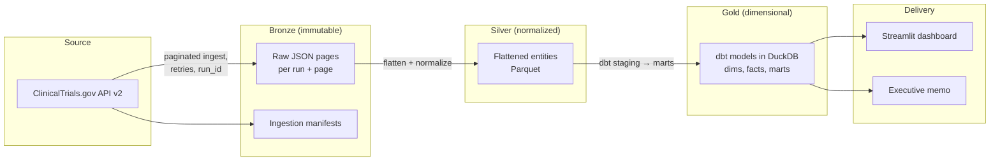
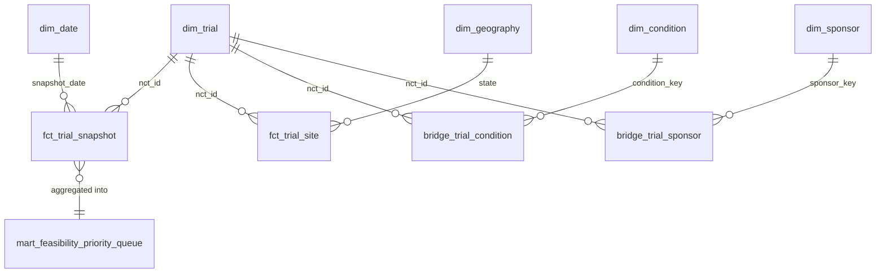

# Clinical Trial Access & Feasibility Intelligence

[](https://github.com/ne1cc/cti-dashboard/actions/workflows/ci.yml)

**Live demo:** [cti-dashboard.fly.dev](https://cti-dashboard.fly.dev/)

**An open, multi-stakeholder clinical trial access and intelligence platform providing transparent discovery and competition analytics over public ClinicalTrials.gov registry data.**

The platform serves patients, caregivers, researchers, and feasibility analysts through open registry analytics. Clinical trial participants can search for active trials near them with clear privacy-first contact guidance (ADR 0061, ADR 0065). Research teams and analysts can explore trial activity, sponsor concentration, site overlap, and geographic trends across multiple therapeutic indications without unvalidated paywalls or black-box algorithms.

Analyst feasibility workflows and business case models are preserved as exploratory hypotheses (ADR 0082, archived in [`docs/archive/business_case.md`](docs/archive/business_case.md)). The primary focus is open access trial discovery, reproducible public registry intelligence, and transparent data quality.

This project turns public **ClinicalTrials.gov API v2** records into an inspectable study landscape with contributing NCT IDs, coverage caveats, and an exportable audit. Users can select an indication profile, phase, and captured snapshot to compare distinct study counts, inspect underlying facilities, and evaluate competition metrics.

Counts describe registry listings under displayed rules; they do not establish patient availability, recruitment prospects, or site performance.

## 5-minute quickstart (synthetic fixture data)

Prerequisites: Python 3.11+, [uv](https://docs.astral.sh/uv/), and a clone of this repository.
Run these commands from the repository root; no registry download or API key is needed:

```bash
uv sync --all-groups --frozen
export CTI_PROJECT_ROOT="$PWD/.scratch/fixture-demo"
uv run python -m tests.fixture_warehouse --root "$CTI_PROJECT_ROOT"
cd "$CTI_PROJECT_ROOT"
uv run streamlit run ../../dashboard/app.py
```

> [!NOTE]
> All sample records produced by `tests.fixture_warehouse` are synthetic fixtures designed for reproducible local testing and UI exploration. They do not represent live patient or study data.
> Start Streamlit from `$CTI_PROJECT_ROOT` so audit and staging views resolve relative
> Parquet paths from the fixture directory. A second fixture invocation refuses the
> nonempty destination. To reset, stop Streamlit and remove only the disposable
> `.scratch/fixture-demo` directory from the repository root, then rerun these commands.

**Start here:** [Project brief](docs/project_brief.md) ·
[National Phase 3 Alzheimer's disease case study](docs/feasibility_case_study.md) ·
[Metric definitions](docs/metric_definitions.md) ·
[Archived exploratory business case](docs/archive/business_case.md).
The case study uses an actual local captured dataset and a complete 50-state table;
D.C. and territories appear in a separate supplement. Its observations describe
that dataset, rather than the current live demo.

> **Validation status:** Pipeline checks, dbt contracts, and automated test suites
> are implemented. Commercial feasibility analyst workflows and operational ROI claims
> remain exploratory hypotheses (ADR 0082). Current development headlines the open
> multi-stakeholder access platform (ADR 0040).

---

## Decision Workflow and Operational Output

Agree on scope → compare the captured landscape → inspect contributors and gaps → export evidence → prepare a research shortlist and questions for further review.

The dashboard and audit supply the evidence; analysts and researchers inspect
transparent registry segments. Segments present raw sortable metrics (active recruiting
trials, sponsor concentration HHI, site overlap rate); per ADR 0077, composite scoring
and arbitrary priority bands have been removed.

Weekly snapshots are the proposed collection cadence. Capture age and registry source age are shown separately; a recent capture can contain an older source record. Freshness expectations must be agreed with the reviewer before operational use. There is no enforced freshness SLA.

## Why this needs recurring engineering

A spreadsheet or one-off registry analysis can be sufficient for an isolated question. Repeated reviews need consistent filters and definitions, distinct-study deduplication, retained observations and evidence that a reviewer can inspect.

- **Snapshot history:** Captures reported changes over successive runs from an API that supplies current records; history begins with this project's collection.
- **Shared metric definitions:** dbt models in DuckDB keep counts and grains consistent across the landscape, drill-through and exports.
- **Inspectable evidence:** Contributing NCT IDs, coverage, exclusions and source lineage explain what a count includes and what remains unknown.
- **Reliable delivery:** Python ingestion, typed Parquet entities, quality checks and CI support reproducible preparation of the Streamlit views and audit exports.

The [archived business case](docs/archive/business_case.md) details an exploratory evaluation hypothesis:
preparation minutes per comparable review, completeness of required handoff fields,
and successful count reproduction. The captured
[national case study](docs/feasibility_case_study.md) demonstrates calculation and
evidence preparation; stakeholder adoption and business improvement remain unmeasured.

---

## Architecture



Full detail: [`docs/architecture.md`](docs/architecture.md).

## Data Model



## Project Scope and Indication Profiles

- **Therapeutic area:** Alzheimer's disease and related dementias (config-driven taxonomy).
- **Geography:** United States (all raw records preserved; U.S.-only in marts).
- **Study type:** Interventional (`AREA[StudyType]INTERVENTIONAL`).
- **Statuses:** All 8 overall statuses: `RECRUITING`, `ACTIVE_NOT_RECRUITING`, `NOT_YET_RECRUITING`, `COMPLETED`, `TERMINATED`, `WITHDRAWN`, `SUSPENDED`, `ENROLLING_BY_INVITATION`. Defined authoritatively in `config/profiles/adrd.yml` and referenced by `config/project_config.yml` (`default_profile: adrd`).
- **Downstream implications of the 8-status scope:**
  - **Tracked trial totals:** Total trial counts (`dim_trial`, `trial_count`, warehouse trials) reflect the entire interventional landscape across all 8 statuses, rather than only active/completed studies.
  - **Stopped studies & feasibility risk:** Studies that stopped early (`TERMINATED`, `WITHDRAWN`, `SUSPENDED`) are ingested and retained, powering why-stopped and feasibility risk analyses.
  - **Similarity candidate pool vs. recruiting competition:** The candidate pool for trial similarity scoring spans all 8 statuses to identify relevant precedents across past and stopped trials, while active competition metrics (`recruiting_trial_count`, `new_recruiting_30d/90d`, `sponsor_hhi`, and priority scoring) strictly isolate confirmed currently-recruiting studies (`overall_status = 'RECRUITING'`).
- **Phases:** EARLY_PHASE1 – PHASE4 where available.
- **Cadence:** Weekly snapshots; history accrues from this project's own runs.

### Optional: Full-Catalog Ingestion

An opt-in, additive ingestion profile snapshots the **entire** ClinicalTrials.gov registry — all conditions, worldwide, no status/type filter (~600k+ studies as of this writing). Run it with `make ingest-full-catalog` (equivalently `python -m src.cli ingest --profile full_catalog`). It writes to a completely separate bronze tree (`data/bronze/full_catalog/`, declared in `config/profiles/full_catalog.yml`) and cannot interfere with the default ADRD/US pipeline above. Combining `--condition` with this profile is rejected: the profile's scope is all conditions by definition.

**Bronze only.** That profile is marked `ingest_only`, so `python -m src.cli transform --profile full_catalog` refuses with exit code 2: there is no condition taxonomy to group trials by, and a taxonomy-less silver tree would be misleading rather than useful. Its former `make transform-full-catalog` target and the private silver tree it wrote are retired; `python -m src.cli transform --profile <id>` flattens one named profile from its own manifests under `data/bronze/<profile_id>/manifests/` (a bare `make transform` is the legacy `default` alias, i.e. `adrd`), and `make orchestrate` runs every refreshable profile end to end (the migration record is in [`docs/archive/development_log.md`](docs/archive/development_log.md)). The chunked streaming writer that target used (`src/transform/export_parquet.py`: bounded-memory Parquet row groups, no full-run materialization) is the same one every transformable profile writes through. Gold, dbt marts, and the dashboard read the single shared silver root, so full-catalog bronze reaches the warehouse only when a taxonomy exists for it; see [`docs/architecture.md`](docs/architecture.md) for the remaining scaling work (extending the condition/geography rules beyond ADRD/US).

---

## Setup and Development

Prerequisites: Python 3.11+, [uv](https://docs.astral.sh/uv/), `make`.

### Installation

```bash
git clone <your-repo-url> cti-dashboard
cd cti-dashboard
make setup
```

`make setup` runs `uv sync --all-groups`, copies `.env.example` → `.env`, and creates the git-ignored `data/` directories. Dependencies are declared in [`pyproject.toml`](pyproject.toml).

### Environment Configuration

Copy [`.env.example`](.env.example) to `.env`. No API keys are needed — the API is public. Variables control local paths, logging, and optional HTTP overrides.

### Running Ingestion and Snapshots

```bash
make ingest                      # python -m src.cli ingest --condition "Alzheimer Disease"
```

For the opt-in full-catalog profile instead, see [Optional: Full-Catalog Ingestion](#optional-full-catalog-ingestion).

Run `make ingest` weekly (cron, systemd timer, or GitHub Actions). Each run gets a unique `ingestion_run_id`; completed runs are never silently re-downloaded (incremental default), and `make full-refresh` forces a complete re-pull.

### Running dbt Models and Tests

```bash
make dbt-run
make dbt-test
```

### Data Quality Reporting

```bash
make quality-report
```

### Local Dagster Orchestration

```bash
make dbt-deps                     # one-time: dbt packages
uv run dbt parse --project-dir dbt_clinical_trials --profiles-dir dbt_clinical_trials
uv run dagster dev -m src.orchestration.definitions
```

`dagster dev` opens the web UI at http://localhost:3000 showing the bronze→silver→gold asset graph. Materialize assets manually from the UI, or execute the weekly job headlessly:

```bash
uv run dagster job execute -m src.orchestration.definitions -j weekly_refresh
```

Headless execution hits the real ClinicalTrials.gov API; local `dagster dev` is for inspection, manual materializations, and ad-hoc re-runs (backfills are deliberately not part of the design).

### Starting the Streamlit Dashboard

```bash
make dashboard
```

---

## Analytical Methodology and Guardrails

### Data Model and Grains

| Layer | Object | Grain |
|---|---|---|
| Silver | `silver_trials` | NCT ID × ingestion run |
| Silver | `silver_trial_locations` | profile × NCT ID × run × original location ordinal |
| Gold | `dim_trial` | NCT ID |
| Gold | `fct_trial_snapshot` | NCT ID × snapshot date |
| Gold | `fct_trial_site` | NCT ID × facility × city × state × snapshot date |
| Gold | `mart_feasibility_priority_queue` | condition group × state × phase × latest snapshot |

### Metric Definitions

Fully documented in [`docs/metric_definitions.md`](docs/metric_definitions.md). Core rules: trial counts are always `COUNT(DISTINCT nct_id)`; site counts use the documented facility grain and are never presented as investigator capacity; only complete (`success`) snapshots feed metrics.

### Registry Segment Metrics Methodology

Segments are evaluated using transparent, observable registry metrics: active recruiting trial counts, Herfindahl-Hirschman Index (HHI) sponsor concentration, site overlap rate, and data completeness adjustments. Per ADR 0077, composite scoring and arbitrary priority bands have been removed in favor of direct sorting by raw metrics.

### Data-Quality and Clinical Interpretation Guardrails

Automated checks cover ingestion integrity, trial validation, relationship integrity, geographic validity, and metric rules — including schema and singular dbt data tests, comprehensive pytest test suites, cross-layer reconciliation, and schema-drift detection ([`docs/data_quality_framework.md`](docs/data_quality_framework.md)). Interpretation guardrails prohibit claims about recruitment failure, patient eligibility, healthcare quality, or sponsor performance ([`docs/clinical_interpretation_guardrails.md`](docs/clinical_interpretation_guardrails.md)).

### Competition Audit Drill-Through

Open **Data coverage and caveats** on any competition-bearing page to inspect metric definitions, exact filters, profile and run IDs, contributing NCT IDs, exclusions, and location details. The panel separates pipeline age, posted updates, and verification age, and provides downloadable audit JSON artifacts (`competition-audit-v2`).

For complete drill-through specifications, provenance requirements, and analytical limitations, see [`docs/competition_audit.md`](docs/competition_audit.md).

### Limitations

- Registry records can be incomplete, delayed, or inconsistently updated.
- Status history begins when this project's snapshots begin.
- Facility names are not stable unique identifiers; normalization is best-effort.
- Raw recruiting counts are not population-adjusted.
- Portfolio demonstration only; real decisions require qualified clinical-operations review. See [`docs/assumptions_and_limitations.md`](docs/assumptions_and_limitations.md).

### Scenario-Value Methodology

No fake ROI. A configurable scenario calculator (`config/roi_assumptions.yml`) lets an organization test whether a feasibility-review process could justify its cost using *its own* site-startup and study-burn assumptions, under low/base/high scenarios.

---

## Documentation Index

| Document | Contents |
|---|---|
| [`PROJECT_DOCUMENTATION.md`](PROJECT_DOCUMENTATION.md) | documentation index and compatibility guide |
| [`docs/study_guide.md`](docs/study_guide.md) | guided learning path: run it, trace a record, read the code, exercises |
| [`docs/architecture.md`](docs/architecture.md) | pipeline and layer design, contracts, and architecture diagrams |
| [`docs/data_dictionary.md`](docs/data_dictionary.md) | every layer, entity, and column specification |
| [`docs/source_documentation.md`](docs/source_documentation.md) | API v2 usage, verification, and history caveats |
| [`docs/metric_definitions.md`](docs/metric_definitions.md) | formula and grain for every metric and score |
| [`docs/competition_audit.md`](docs/competition_audit.md) | competition audit panel specification, drill-through, and audit JSON artifacts |
| [`docs/archive/business_case.md`](docs/archive/business_case.md) | archived exploratory analyst persona and business case hypothesis (ADR 0082) |
| [`docs/clinical_interpretation_guardrails.md`](docs/clinical_interpretation_guardrails.md) | required/prohibited language and enforcement |
| [`docs/assumptions_and_limitations.md`](docs/assumptions_and_limitations.md) | numbered assumptions register |
| [`docs/data_quality_framework.md`](docs/data_quality_framework.md) | check layers, tests, severity philosophy, and CI gates |
| [`docs/dashboard_spec.md`](docs/dashboard_spec.md) | page-by-page dashboard specification |
| [`docs/project_brief.md`](docs/project_brief.md) | proposed stakeholder workflow, scope, and acceptance criteria |
| [`docs/feasibility_case_study.md`](docs/feasibility_case_study.md) | national descriptive memo, complete state table, and evidence appendix |
| [`docs/executive_memo_template.md`](docs/executive_memo_template.md) | stakeholder memo template with required scope and evidence references |
| [`docs/DEPLOY_STREAMLIT.md`](docs/DEPLOY_STREAMLIT.md) | deploy the dashboard to Streamlit Community Cloud |
| [`docs/DEPLOY_FLY.md`](docs/DEPLOY_FLY.md) | deploy the dashboard to Fly.io with an auto-refreshing pipeline |
| [`docs/competitive_positioning.md`](docs/competitive_positioning.md) | positioning as an open feasibility workbench vs. commercial platforms |
| [`docs/archive/development_log.md`](docs/archive/development_log.md) | historical step-by-step build record (Phases 1–7) |
| [`docs/archive/platform_updates_2026-09-04.md`](docs/archive/platform_updates_2026-09-04.md) | historical architecture and tooling updates |

## Roadmap

1. MVP: ClinicalTrials.gov-only pipeline, marts, dashboard (Phases 1–7).
2. ACS population layer for population-adjusted density.
3. CDC/ATSDR SVI county-level access-barrier context.
4. Optional oncology module via NCI CTS API.
5. Warehouse portability (BigQuery/Snowflake) and orchestration (Dagster/Airflow).

---

**Disclaimer:** Source: ClinicalTrials.gov public registry data. This project is an analytical portfolio demonstration. Metrics are feasibility-review signals, not enrollment forecasts. Validate with qualified clinical-operations teams before any real-world use.
